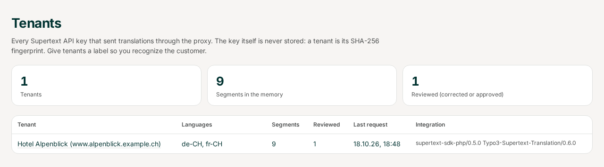
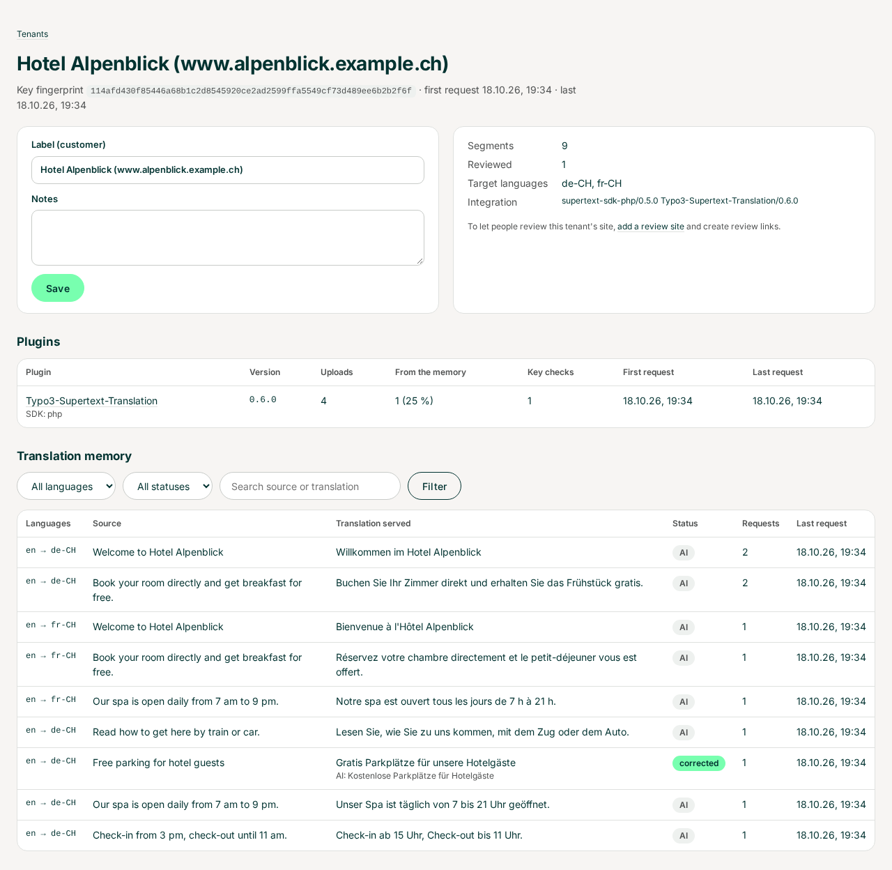
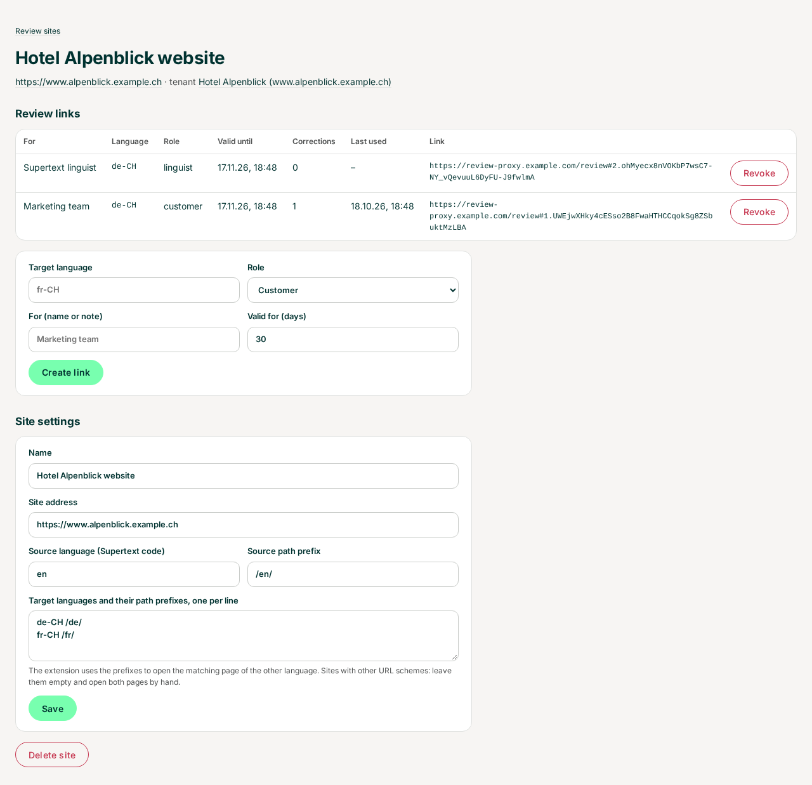
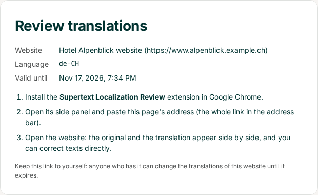
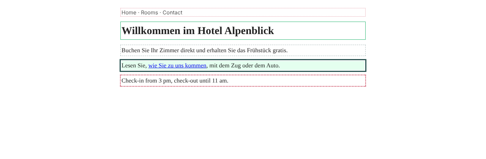
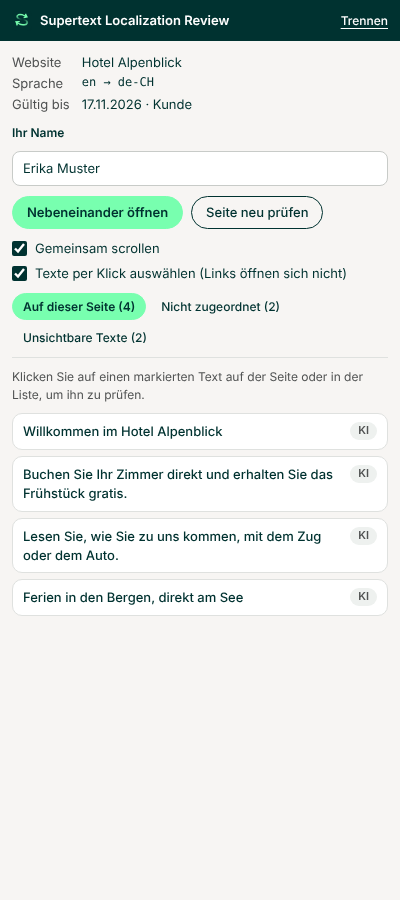
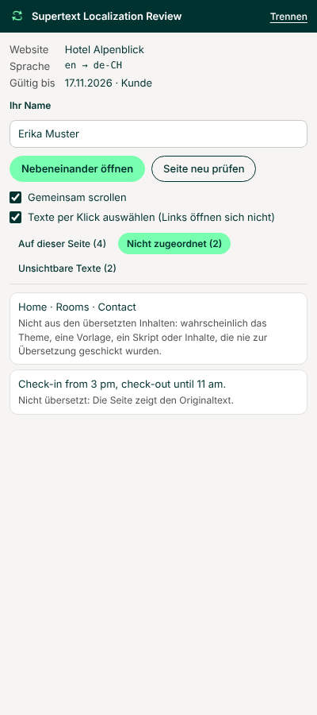
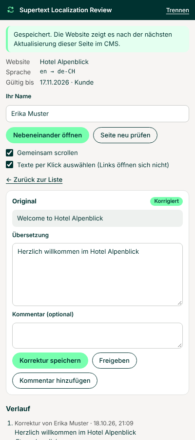

# User guide

For Supertext staff using the translation proxy's pages (in English; sign in with the shared password), and for reviewers (customers and Supertext linguists) using the Chrome extension: see [Reviewing a website](#reviewing-a-website).

## Tenants

A **tenant** is one Supertext API key that sent translations through the proxy. The proxy never stores the key itself, only its SHA-256 fingerprint, so a tenant first appears as *Key 114afd430f…*. The *Tenants* tab lists them with their target languages, how many texts the memory holds, how many were reviewed, the last request and which plugin sent it.

Open a tenant to give it a **label** (the customer's name and site) and notes. Below is its **translation memory**: every text the plugin sent, per language pair, with the translation the proxy serves and its status:

- **AI**: the AI translation as Supertext first returned it. The proxy serves it every time the same text comes again, so a text never changes by itself.
- **corrected**: a reviewer corrected it; the AI translation is shown underneath. The proxy serves the correction from now on.
- **approved**: a reviewer confirmed the served translation.

*Requests* counts how often the plugin asked for the text. *Newer AI answer* appears when a whole page went to Supertext again and Supertext would now translate a known text differently; the proxy still serves the stored one. Filter by language and status or search the source and translation.

## Plugins using the proxy

Which plugins (name, version, SDK) send their translations through the proxy, per tenant, with their uploads, how many the proxy answered from the memory and their key checks, is shown in the **Commando Center** under *Translation proxy*. The Commando Center reads it from the proxy's usage API; it never sees translations, review sites or links. A tenant's page here lists its plugins too.

## Review sites and links

To let people review a customer's website, add it under **Review sites** → *New review site*:

- **Tenant**: the API key its plugin uses (label tenants first, so you find the right one).
- **Site address**: e.g. `https://www.alpenblick.example.ch`.
- **Source language** (Supertext code, e.g. `en`) and its **path prefix** (`/en/`), and one line per **target language** with its prefix (`de-CH /de/`). The extension uses the prefixes to open the matching page in the other language. Leave them empty when the site's URLs don't follow a prefix scheme.

On the site's page, **create a review link** per person or team: target language, role (*Customer* or *Supertext linguist*), who it is for, and how many days it is valid (1–365). The table shows each link's address to send (`https://…/review#…`; the part after `#` is the key, keep the whole link), when it was last used and how many corrections came through it. **Revoke** stops a link at once. Every correction records the reviewer's name, role and link.

A review link opens a page that explains how to start reviewing:

Anyone who has a link can change that site's translations in that language until it expires, so send links only to the people who should review, and revoke links you no longer need.

## How corrections reach the website

The proxy serves a correction the next time the plugin asks for that text: when an editor translates the page again, or the plugin translates it again on its own. Corrections don't yet appear on the website by themselves; pushing them to the CMS directly is on the roadmap.

## Reviewing a website

For customers and Supertext linguists. You need Google Chrome, the **Supertext Localization Review** extension (see the installation guide) and a review link from Supertext. The extension's texts follow Chrome's language (English, German, French or Italian); the screenshots show German.

1. Click the extension's icon in Chrome's toolbar: its side panel opens on the right and stays open while you work.
2. Paste the review link and click *Connect*. The first time, Chrome asks whether the extension may read the website: allow it. Enter your name: every change records who made it.
3. Open a page of the website (or click *Open side by side* to start on the home page). The extension opens the original next to the translation in Chrome's split view: original left, translation right. If your Chrome can't do that itself, it tells you the shortcut (Shift+Alt+N, Mac: Cmd+Option+N).
4. Texts are marked on both pages: a dashed frame for AI translations, green for corrected or approved ones, red dots for texts that were not translated, light red dots for other texts the review doesn't know. With *Scroll together* on, the original follows when you scroll the translation.

The panel lists what it found on the page:

- **On this page:** the translated texts, with their status (*AI*, *Corrected*, *Approved*).
- **Not matched:** texts on the translated page that don't belong to a translation, with the likely reason: *Not translated* (the page shows the original text), or texts that don't come from the translated content (the theme, a template, a script, or content that was never sent for translation). These can't be corrected here; tell Supertext or your web agency.
- **Invisible texts:** the page title, meta descriptions, image alt texts, tooltips, form placeholders and structured data. Those that belong to a translation can be corrected like any other text.

Click a text in the list or on the page (with *Select texts by clicking* on, clicking a link selects its text instead of opening it). The panel shows the original and the translation:

- Change the translation and click **Save correction**; add a comment if you like. Texts with formatting or links show the HTML tags: change only the words between them. Changed or added tags or links are refused, so a correction can never break the page.
- **Approve** confirms the translation as it is. **Add comment** leaves a note without changing anything.
- The **History** shows the AI translation and every correction, approval and comment with who made it.

The website shows a correction after the page is next updated in the CMS (when the editors translate it again); the review doesn't change the live site by itself.
